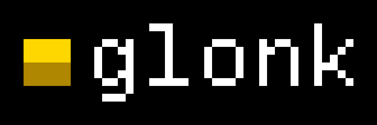

# The glonk brand

Every game starts with a block. In a terminal that block is a cell, and that cell is glonk's mark.



## The mark

Two terminal cells of the upper half block, `▀▀`: a lit half over a darker front. Read flat, it is the pixel glonk draws with, two to a cell. Read solid, it is a block seen from the front and a little above. A terminal with 16 colors can print it:

```
printf '\033[93;43m▀▀\033[0m glonk\n'
```

- It is a square in two equal halves, the lit one on top. Nothing else: no outline, no face, no shadow.
- Beside the name it is exactly as tall as the letters g, o and n, stands on the line they stand on, and is three pixels from the g.
- Half the mark's width is kept clear around the two.

## The name

glonk, always in lower case, also where a sentence starts. As a logo it is set in Departure Mono at that typeface's own size, where every stroke is one pixel wide, and it is drawn as pixels: scaled by whole numbers, never smoothed.

## Colors

There are two grounds. Night is a terminal: every color on it is one of the 256 a terminal has, given here by its number. Paper is a page.

| | Night | Paper |
|---|---|---|
| Ground | 16 `#000000` | `#e7ecf0` |
| The name | 231 `#ffffff` | `#14213d` |
| Text | 254 `#e4e4e4` | `#14213d` |
| Quiet text | 245 `#8a8a8a` | `#46567a` |
| The mark, lit | 220 `#ffd700` | 178 `#d7af00` |
| The mark, front | 136 `#af8700` | 94 `#875f00` |

- The mark is gold on both grounds, one step darker on paper so that it holds against a light page.
- Gold belongs to the mark. At night it may also show what can be pressed or typed: a link, a prompt.
- Text has a contrast of at least 4.5 to 1 with its ground, and the front of the mark at least 3 to 1. The tests in `internal/brand` hold both to it.

glonk.dev follows the visitor's light or dark setting. A picture that is published once, such as the one at the top of the README, is the night one.

## Type

- **Departure Mono**, by Helena Zhang, for the name, for headings, and for everything that sits in cells: code, figures, tables of characters. It has one weight, so a heading is the same letters at two or three times the size, not a bolder face.
- **Literata**, by the Literata Project Authors, for prose.

Both are under the SIL Open Font License 1.1. A cell is one wide and two tall, and a page is laid out on that grid: text in Departure Mono sits one character to a cell.

On glonk.dev a cell is 14 by 28 pixels, which is Departure Mono at 22 pixels, twice its drawn size. Headings are that at two and three times, and prose is Literata at 19 pixels on the 28 pixel rows. The page is 84 cells wide, or 60 where 84 do not fit. On a phone the cell is three quarters of that, 10.5 by 21, and code is at the face's drawn size of 11 pixels. In the manual and the changelog the contents list is at three quarters, 16.5 pixels, and code is at the face's drawn size on rows of 14 pixels, half a cell, as the text in the recordings is, so that 96 characters fit the 50 cells of text. The fonts are files of the site, in `site/media/fonts/` with their licenses, and the pages ask no other site for anything. On glonk.dev Cloudflare adds its Web Analytics beacon at the edge, a setting of the account that is kept (2026-11-19).

## Voice

glonk says what it does and what was measured, in plain words, and stops.

- The line: **Every game starts with a block.**
- What it is: a terminal rendering engine for Go: 2D, 3D, or both in one frame.
- A release note says what changed, what to check before upgrading, and what was not measured.
- No exclamation marks, no "blazing" or "powerful", and nothing promised that is not built.

## Not this

- GLONK, Glonk, or the name in another typeface as a logo.
- The mark with a face, an outline, a glow, rounded corners or a tilt.
- The mark in another hue, or with its dark half on top.
- A creature. glonk has no mascot.

## Using the mark

The files in `brand/` are under the MIT license, as the rest of this repository is. Use the mark and the name to say that something is made with glonk, or is about glonk. Please do not use them as the logo of something else, or in a way that suggests glonk endorses it.

For the README of something made with glonk there is a badge, the mark and "made with glonk" on the night ground, at the height of the usual badges and at one address that stays:

```
[](https://glonk.dev)
```

## Files

| File | For |
|---|---|
| `brand/glonk-night.svg`, `brand/glonk-night.png` | The mark and the name on a dark page |
| `brand/glonk-paper.svg`, `brand/glonk-paper.png` | The same on a light page |
| `brand/mark.svg`, `brand/mark.png` | The mark alone |
| `site/favicon.svg`, `site/favicon.ico`, `site/apple-touch-icon.png` | The icons of glonk.dev |
| `site/card.png` | The card shown beside a link to glonk: the logo, what glonk is, and a block the engine drew |
| `site/badge.svg` | The "made with glonk" badge, served at glonk.dev/badge.svg for the READMEs of other projects |
| `site/block.png` | The picture of the first step on glonk.dev: the card's block, drawn by the engine |

Their source is `internal/brand/brand_test.go`: the name and the card's words as rows of pixels, the mark's colors as terminal color numbers, and the card's block as a scene, all drawn with glonk itself. `make brand` writes the files again, and `make check` fails if one of them is not what the source draws.
