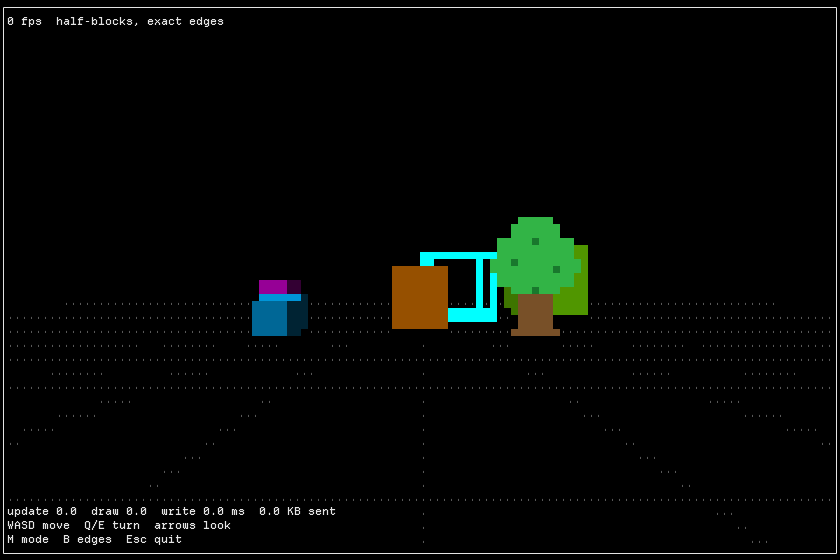
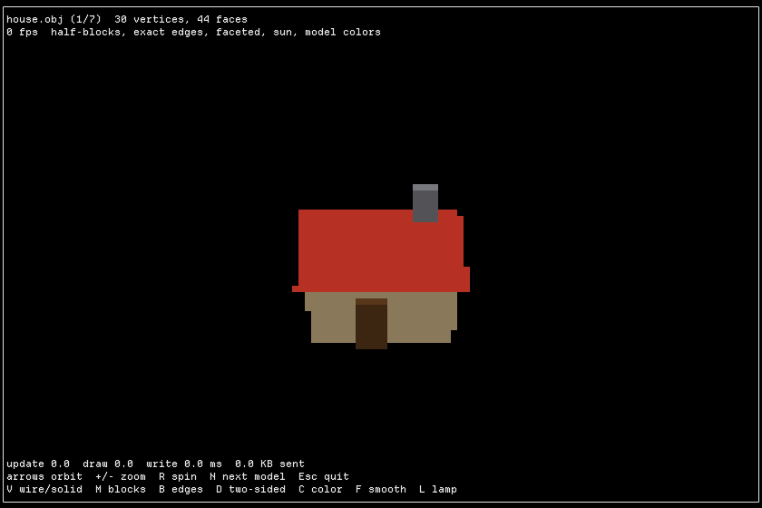
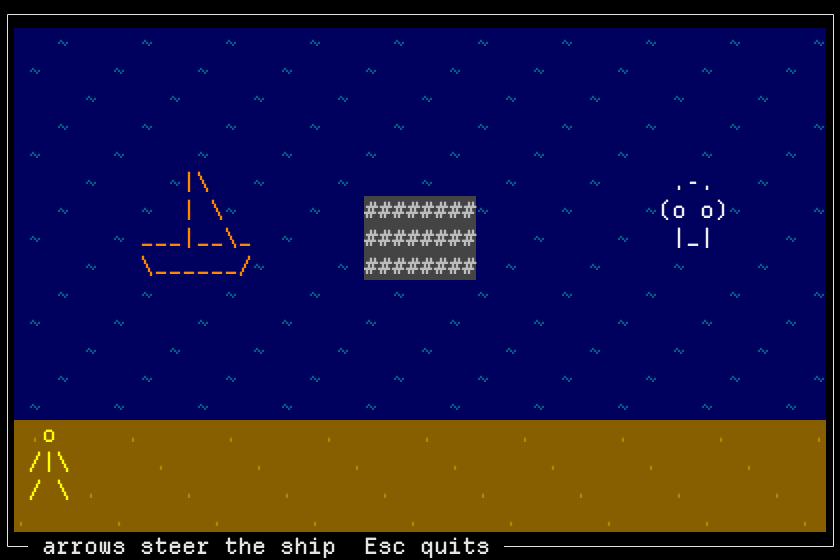
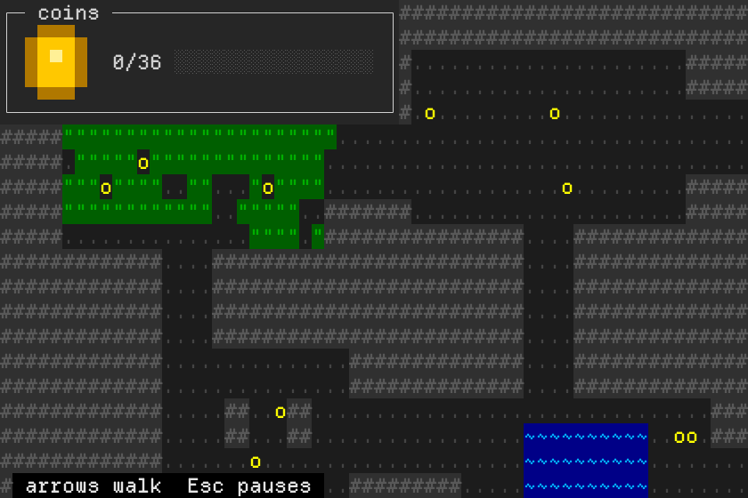

<h1>
  <picture>
    <source media="(prefers-color-scheme: dark)" srcset="brand/glonk-night.svg">
    
  </picture>
</h1>

Every game starts with a block.

glonk is a terminal rendering engine for Go. It draws 2D, 3D, or both in one frame: text, sprites, tile maps and widgets in cells, and shaded meshes and pictures on a canvas of two pixels to a cell.



Website and manual: [glonk.dev](https://glonk.dev)

> Early and pre-1.0: the API may change.

## Install

```
go get glonk.dev
```

glonk needs Go 1.26 or newer. It has no package at its root: import the packages you use, `glonk.dev/engine` first, and run `go mod tidy` once.

## A first game

```go
package main

import (
	"context"
	"fmt"
	"os"

	"glonk.dev/engine"
)

type game struct{ x float64 }

func (g *game) Update(dt float64, in *engine.Input) error {
	if in.Pressed(engine.KeyEscape) {
		return engine.ErrQuit
	}
	g.x += 20 * dt // cells per second
	return nil
}

func (g *game) Draw(fb *engine.FrameBuffer) {
	fb.DrawBox(0, 0, fb.Width(), fb.Height(), engine.Color{})
	fb.Set(int(g.x)%fb.Width(), fb.Height()/2,
		engine.Cell{Character: '@', Foreground: engine.Palette(208)})
}

func main() {
	err := engine.Run(context.Background(), &game{}, engine.Config{FPS: 30})
	if err != nil {
		fmt.Fprintln(os.Stderr, err)
		os.Exit(1)
	}
}
```

A box fills the window and an @ walks across it. Esc quits. It is [examples/hello](examples/hello), and [Your first game](docs/first-game.md) says what each part does.

## The manual

| Guide | For |
|---|---|
| [Your first game](docs/first-game.md) | The loop, cells and colors, how a run ends, frame numbers |
| [Keys, text and the mouse](docs/input.md) | Held keys, shortcuts, typing, a paste, the pointer |
| [Testing a game](docs/testing.md) | Pressing keys and reading frames with no terminal |
| [Pixels, shapes and pictures](docs/pixels.md) | The pixel canvas, shapes, pixel text, JPEG and PNG pictures |
| [Sprites, collision and tile maps](docs/sprites.md) | Things that move, walls that stop them, a level bigger than the screen |
| [Widgets](docs/widgets.md) | A label, a panel, a bar, a menu, a text field |
| [A 3D scene](docs/3d.md) | A camera, shapes, lights, wireframes, fog, rays |
| [Models and textures](docs/models.md) | OBJ files, colors on each vertex, pictures on faces, see-through faces |
| [A game in a web page](docs/web.md) | The same game, played in a browser |
| [Terminals, colors and limits](docs/terminals.md) | What a terminal needs, and what glonk does not do |

The guides are also at [glonk.dev/manual](https://glonk.dev/manual/). Every type and function is documented, with examples that run, on [pkg.go.dev](https://pkg.go.dev/glonk.dev).

## Examples

| | |
|---|---|
| [](site/media/cube3d.gif)<br>**cube3d**: walk among shaded cubes, a tree that is a picture, and a cube drawn as lines. | [](site/media/viewer.gif)<br>**viewer**: the bundled models and shapes, solid or as lines, faceted or smooth. |
| [](site/media/sprites.gif)<br>**sprites**: a ship you steer round a rock, a walking figure and a blinking ghost. | [](site/media/world.gif)<br>**world**: a level bigger than the screen, with walls, coins, a coin panel and a pause menu. |

The pictures are what the engine drew, from a script of key presses with no terminal. Each example runs without a clone:

```
go run glonk.dev/examples/viewer@latest
```

[examples](examples) lists all seven, with their keys.

## Status

- **Built to work in most terminals,** at its best in one with true color and the kitty keyboard protocol. Windows is untested. [Terminals, colors and limits](docs/terminals.md) has the details.
- **What changed** in each release is in the [CHANGELOG](CHANGELOG.md).
- **What is planned** is in [issues](https://github.com/usrgames/glonk/issues), grouped by [milestone](https://github.com/usrgames/glonk/milestones). Ideas, not promises.

## Moved to glonk.dev

Up to v0.1.0 glonk was imported as `github.com/kyrokohan/glonk`. From v0.2.0 it is `glonk.dev`; the code is on GitHub at `github.com/usrgames/glonk`. To move a project that uses v0.1.0, run this in its module root (it needs `perl`, which macOS and most Linux systems have):

```
go mod edit -droprequire github.com/kyrokohan/glonk
grep -rl 'github.com/kyrokohan/glonk' --include='*.go' . | xargs perl -pi -e 's#github.com/kyrokohan/glonk#glonk.dev#g'
go get glonk.dev@latest
go mod tidy
```

## Contributing

Issues and pull requests are welcome: see [CONTRIBUTING.md](CONTRIBUTING.md), which also says how to build and test glonk. Everyone taking part follows the [code of conduct](CODE_OF_CONDUCT.md). To report a security problem privately, see [SECURITY.md](SECURITY.md). If you built something with glonk, it can be listed on [glonk.dev/showcase](https://glonk.dev/showcase/).

## License

MIT. See [LICENSE](LICENSE).
